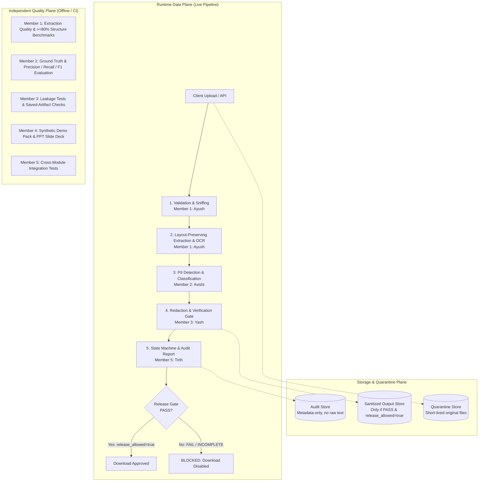

# PII Guard: Enterprise Text Analysis & PII Protection Pipeline
### Cadence Financial Group — Cyber Strategy & AI Governance Case Study

A modular, privacy-first document processing pipeline built for **Cadence Financial Group** to enforce strict data protection controls before business artifacts reach downstream AI and Large Language Model (LLM) agents.

---

## 1. Team Roster & Division of Work

The team division is partitioned into strictly bounded technical and presentation tracks:

| Member / Owner | Role | Primary Deliverables & Owned Paths | Added / Bounded Work | Implementation Status |
| :--- | :--- | :--- | :--- | :---: |
| **Member 1: Ayush Sinha** | **Ingestion, Extraction & OCR** | `src/pii_guard/ingestion/`<br>`tests/test_ingestion.py`<br>`docs/ingestion.md` | Layout-preserving parsers (PDF, DOCX, PPTX, TXT), adaptive OCR, magic byte sniffing, zip-bomb defense, $\ge 80\%$ structure retention scoring. | **COMPLETED** |
| **Member 2: Avishi Sharma** | **PII Detection & Classification** | `src/pii_guard/detection/`<br>`tests/test_detection.py`<br>`evaluation/`<br>`docs/detection.md` | Entity identification, span classification, Presidio & regex patterns, detection confidence scores, ground-truth annotations. | **COMPLETED / INTEGRATED** |
| **Member 3: Yash Jhinkwan** | **Redaction, Verification & Release Gate** | `src/pii_guard/redaction/`<br>`tests/test_redaction.py`<br>`docs/security.md` | Contextual token replacement (`<PERSON_1>`), secondary re-scan verification, saved-artifact checks, structure preservation. | **COMPLETED / INTEGRATED** |
| **Member 4: Anshika** | **Demo Fixtures, Manifest & Presentation** | `demo_tools/`<br>`demo_samples/`<br>`src/pii_guard/reporting/metrics.py`<br>`tests/evaluation/`<br>`Presentation (.pptx)` | Deterministic synthetic PII generator (`--seed`), ground-truth manifest, bipartite matching evaluation metrics (Precision, Recall, F1, FNR, IoU), PowerPoint slide deck narrative & rehearsal. | **COMPLETED** |
| **Member 5: Tirth Bora** | **Orchestration, UI, Audit & Integration** | `src/pii_guard/orchestration/`<br>`src/pii_guard/reporting/`<br>`app.py`<br>`tests/unit/`, `tests/integration/`, `tests/security/` | Cross-module finite state machine, dual-key release gate barrier, tokenized artifact sandbox, metadata-only audit ledger, Streamlit UI, end-to-end integration tests. | **COMPLETED** |

---

## 2. Key Capabilities

- **Multi-Format Extraction:** Preserves visual reading order and layout across digital PDFs, scanned documents, Word documents, PowerPoint presentations, and plain text.
- **Adaptive OCR Engine:** High-speed 200 DPI fast-path rasterization with 300 DPI fallback, OpenCV deskewing, and adaptive Otsu binarization for degraded scans.
- **Fail-Closed Security Layer:** Magic byte sniffing (rejects renamed binaries), zip-bomb defense (ratio $\le 100:1$), encrypted PDF blocking, and zero unhandled exceptions.
- **Deterministic Downstream Offsets:** Single-pass Unicode NFC normalizer ensuring `text` is the immutable source of truth for downstream detection spans.
- **High-Precision PII Detection & Token Redaction:** Multi-entity identification with contextual token masking (`<PERSON_1>`, `<EMAIL_ADDRESS_1>`, `<US_SSN_1>`).
- **Independent Verification & Dual-Key Release Gate:** Mathematically prevents unredacted document egress. Downstream download is blocked unless post-redaction re-scan strictly passes (`PASS`) and `release_allowed == True`.
- **Controlled Artifact Sandbox & Sanitized Error Hierarchy:** Prevents path traversal (`..`, null-byte injections) through cryptographic artifact tokens; scrubs stack traces so no raw text or host paths are exposed.
- **Thread-Safe Audit Trail & Metadata-Only Reporting:** Records all pipeline lifecycle events using strict allowlist projection with zero raw PII retention.
- **Interactive Streamlit UI:** Complete web application with side-by-side inspection, stage telemetry, and gated artifact downloads.

---

## 3. High-Level Architecture & Lifecycle

The system is partitioned into three independent operational planes:



### Pipeline Lifecycle States
`RECEIVED` $\rightarrow$ `VALIDATED` $\rightarrow$ `EXTRACTED` $\rightarrow$ `DETECTED` $\rightarrow$ `REDACTED` $\rightarrow$ `VERIFIED` $\rightarrow$ `RELEASED`
- Any technical fault transitions to `FAILED`.
- Any unverified or leaking redaction transitions to `BLOCKED`.
- Any missing required verification transitions to `INCOMPLETE`.
- All states except verified `PASS` prevent client download.

---

## 4. Contract Interfaces Summary

Communication between modules is governed by four strict data contracts:

| Contract | Schema Name | Producer | Consumer | Key Purpose & Guarantees |
| :--- | :--- | :--- | :--- | :--- |
| **Contract A** | `ExtractedDocument` | **Ingestion (M1)** | **Detection (M2) & Pipeline (M5)** | Normalized single-source-of-truth text, exact character offsets, per-page metadata, layout metrics, `extraction_status`. |
| **Contract B** | `DetectionResult` | **Detection (M2)** | **Redaction (M3) & Pipeline (M5)** | Classified entity spans (`type`, `start`, `end`, `confidence`) mapped into `ExtractedDocument.text`. |
| **Contract C** | `RedactionResult` | **Redaction (M3)** | **Orchestration (M5)** | Redacted text, `artifact_ref`, `redactions_applied`, `verification_status` (`PASS`/`FAIL`/`INCOMPLETE`), and `release_allowed` boolean flag. |
| **Contract D** | `ProcessingReport` | **Reporting (M5)** | **Client / Enterprise Audit** | Metadata-only audit ledger (entity counts by category, timestamps, versions); strictly zero raw PII. |

---

## 5. Repository Directory Structure

```text
Optive_Case_study/
├── server.py                           # Member 5 - FastAPI HTTP Adapter & Static Server
├── frontend/                           # React + TypeScript + Vite Web Application
│   ├── src/
│   │   ├── components/                 # Inspector, Diff View, AI Copilot, Audit Ledger
│   │   ├── App.tsx                     # Main Dashboard
│   │   └── index.css                   # Glassmorphic Tailwind/CSS Design Tokens
│   ├── package.json                    # Frontend dependencies
│   └── vite.config.ts                  # Vite build & API proxy configuration
├── app.py                              # Legacy Streamlit Web Application
├── requirements.txt                    # Core & testing dependencies
├── requirements-ingestion.txt          # Ingestion-specific dependencies
├── pytest.ini                          # Pytest configuration
├── README.md                           # Master project documentation
│
├── benchmarks/
│   └── bench_ingestion.py              # Ingestion throughput and latency benchmark
│
├── evaluation/                         # Member 2 Evaluation & Ground Truth
│   ├── build_ground_truth.py           # Evaluation corpus builder
│   └── ground_truth.jsonl              # 28 annotated evaluation documents
│
├── demo_tools/                         # Member 4 - Synthetic Data Generator
│   └── generate_synthetic_samples.py   # Seeded deterministic generator (10 scenarios)
├── demo_samples/                       # Generated synthetic fixtures & manifest
│   ├── manifest.json                   # Ground-truth annotations & metadata
│   └── *.txt / *.docx / *.pptx         # Test fixtures (emails, loans, wires, attacks)
│
├── docs/                               # Engineering Documentation
│   ├── architecture.md                 # System architecture, operational planes & state machine
│   ├── security.md                     # Security controls, threat model & invariants
│   ├── detection.md                    # Detection module handbook & synthetic evaluation
│   ├── ingestion.md                    # Ingestion module handbook & handoff
│   ├── interfaces.md                   # Full JSON schemas for Contracts A, B, C, D
│   ├── integration_audit.md            # Integration architecture verification & call chain
│   ├── integration_issues.md           # Defect tracker & issue resolution ledger
│   ├── test_execution_report.md        # Comprehensive test execution & regression report
│   ├── demo_runbook.md                 # Presenter live execution demonstration guide
│   ├── demo_script.md                  # Presentation walkthrough
│   ├── member5_member4_commit_log.md   # Chronological commit log & audit record
│   └── member5_member4_implementation_plan.md # Checklist of completed deliverables
│
├── src/
│   └── pii_guard/
│       ├── __init__.py                 # Root package initializer
│       ├── ingestion/                  # Member 1 (Ayush Sinha) - Ingestion & OCR
│       │   ├── adapters/               # Multi-format adapters (PDF, DOCX, PPTX, TXT)
│       │   ├── config.py               # Timeouts, limits, and Tesseract path resolution
│       │   ├── extractor.py            # Central extraction & offset calculator
│       │   ├── normalize.py            # Single-pass deterministic normalizer
│       │   ├── ocr.py                  # Tesseract & RapidOCR adaptive engines
│       │   ├── quality.py              # Extraction completeness & structure metrics
│       │   ├── router.py               # Format registry router
│       │   ├── schemas.py              # Contract A schemas (ExtractedDocument)
│       │   └── validator.py            # Magic byte, zip-bomb, and security checks
│       ├── detection/                  # Member 2 (Avishi Sharma) - PII Detection
│       │   ├── classifier.py           # Overlap resolution and classification
│       │   ├── detector.py             # Public detection entry point (Contract B)
│       │   ├── ner_detector.py         # NER models and contextual extraction
│       │   ├── pattern_detector.py     # Regex patterns with checksum validation
│       │   ├── schemas.py              # Contract B models (DetectionResult)
│       │   └── validators.py           # Luhn, SSN, PAN, IPv4 mathematical validators
│       ├── redaction/                  # Member 3 (Yash Jhinkwan) - Redaction & Release Gate
│       │   ├── gate.py                 # Fail-closed release decision logic
│       │   ├── policy.py               # Replacement token schemas
│       │   ├── redactor.py             # Offset-safe right-to-left masking engine
│       │   ├── schemas.py              # Contract C schemas (RedactionResult)
│       │   ├── service.py              # Stable public facade for orchestrator
│       │   └── verifier.py             # Residual PII detection & structure score
│       ├── orchestration/              # Member 5 (Tirth Bora) - Orchestration & Control
│       │   ├── artifacts.py            # Controlled artifact sandbox & path traversal guard
│       │   ├── errors.py               # Sanitized error hierarchy & regex cleaner
│       │   ├── models.py               # Shared contract models & ProcessingResult
│       │   ├── pipeline.py             # 7-stage pipeline coordinator & fail-closed gate
│       │   └── state.py                # Pipeline finite state machine
│       └── reporting/                  # Member 4 & 5 - Audit, Reporting & Metrics
│           ├── audit.py                # Thread-safe audit trail & allowlist serialization
│           ├── export.py               # Allowlist JSON and CSV exporters
│           ├── metrics.py              # Member 4 - Bipartite matching detection metrics
│           └── report_generator.py     # Contract D JSON report & executive summary
│
└── tests/                              # Comprehensive Automated Test Suite
    ├── test_cli.py                     # CLI output mode tests
    ├── test_config.py                  # Configuration and env override tests
    ├── test_detection.py               # 60 automated tests for Member 2
    ├── test_ingestion.py               # 20 ingestion automated tests for Member 1
    ├── test_redaction.py               # 10 redaction and verification tests for Member 3
    ├── unit/                           # Unit tests for state, errors, audit, reporting, UI
    ├── evaluation/                     # Detection evaluation & bipartite metric tests
    ├── integration/                    # End-to-end pipeline coordination tests
    ├── security/                       # Fail-closed release gate, leakage & traversal tests
    └── fixtures/                       # Deterministic test fixture files
```

---

## 6. Quickstart & How to Run

### 1. Environment Setup (Python 3.12 / 3.13)
```powershell
# Create virtual environment
python -m venv .venv
.\.venv\Scripts\activate   # Windows PowerShell
# source .venv/bin/activate  # macOS / Linux

# Install dependencies
pip install -r requirements.txt
pip install -r requirements-ingestion.txt
```

### 2. Generate Synthetic Demo Fixtures
Generate deterministic test fixtures and ground-truth `manifest.json`:
```powershell
python -m demo_tools.generate_synthetic_samples --output-dir demo_samples --seed 42
```

### 3. Launch the Streamlit Web Application
```powershell
streamlit run app.py
```
Open `http://localhost:8501` to access the interactive processing interface.

### 4. Run the Automated Test Suite
```powershell
# Run the entire test suite
pytest -v

# Run targeted test suites
pytest tests/test_ingestion.py -v
pytest tests/test_detection.py -v
pytest tests/test_redaction.py -v
pytest tests/unit tests/integration tests/security -v
```

### 5. CLI Ingestion Usage
```powershell
python -m src.pii_guard.ingestion tests/fixtures/ingestion/sample.docx --json
```

---

## 7. Extraction Quality & Performance Benchmarks (Member 1)

$$\text{Structure Score} = 0.25 \times \text{Boundaries} + 0.25 \times \text{Headings} + 0.20 \times \text{Paragraphs} + 0.20 \times \text{Tables} + 0.10 \times \text{Reading Order}$$

| Format / Payload | Sample Size | Completeness (RapidFuzz) | Structure Retention Score | Status |
| :--- | :---: | :---: | :---: | :---: |
| **Word Document (DOCX)** | 1 document | **100.0%** | **100.0%** | **PASS** ($\ge 80\%$) |
| **Digital PDF** | 2 pages | **100.0%** | **100.0%** | **PASS** ($\ge 80\%$) |
| **PowerPoint (PPTX)** | 2 slides | **100.0%** | **100.0%** | **PASS** ($\ge 80\%$) |
| **Composite Average** | **5 artifacts** | **100.0%** | **100.0%** | **PASS** ($\ge 80\%$) |

Throughput measured up to **981.6 pages/sec** (Digital PDF) and **4,684 pages/sec** (TXT stream).

---

## 8. Definition of Done (DoD) & Acceptance Criteria

### Member 1 Deliverables (Ayush Sinha)
- **Public API Contract A:** `extract_document(file_path)` returns Pydantic v2 `ExtractedDocument` matching schema.
- **Multi-Format Adapters:** `PDFAdapter`, `DOCXAdapter`, `PPTXAdapter`, and `TXTAdapter` implemented in `adapters/`.
- **Layout & Structure Preservation:** Interleaved paragraphs and tables in DOCX, reading order in PDF, slide hierarchy in PPTX.
- **Selective Adaptive OCR:** Fast-path rasterization with selective Tesseract triggers at 200 DPI, 300 DPI fallback with OpenCV deskew.
- **Malicious & Sanity Defenses:** Sniffs real magic bytes; rejects renamed `.exe`, zip bombs ($\le 100:1$), and encrypted PDFs.
- **Structure Retention Score $\ge 80\%$:** Quantitative weighted score achieved **100.0%** across DOCX, PDF, and PPTX fixtures.

### Member 2 Deliverables (Avishi Sharma)
- **Public API Contract B:** `detect_pii(document)` returning validated `DetectionResult` with `PII_TYPES`.
- **Deterministic Pattern Detectors:** Regex rules with Luhn algorithm validation, US SSN, IN PAN, Email, Phone, IP address.
- **Overlap Resolution:** Strict precedence ordering, span length, confidence, and start offset.
- **Fail-Closed Guarantees:** Rejects failed extractions; drops spans crossing page boundaries (`\f`).
- **Ground Truth Corpus:** 28 synthetic annotated documents with precision/recall/F1 evaluation tools.

### Member 3 Deliverables (Yash Jhinkwan)
- **Public API Contract C:** `redact_and_validate()` returning `RedactionResult` with strict `release_allowed` boolean.
- **Contextual Masking:** Offset-safe replacement applied right-to-left.
- **Saved-Artifact Re-scan:** Reopens stored artifact with format-specific reader before granting `PASS`.
- **Structure Score Enforcement:** Validates line boundaries and heading preservation post-redaction.

### Member 4 Deliverables (Anshika)
- **Deterministic Synthetic Fixture Generator:** `demo_tools/generate_synthetic_samples.py` producing 10 realistic scenarios.
- **Ground Truth Manifest:** `demo_samples/manifest.json` indexing spans, entity categories, and expected outcomes without raw PII.
- **Bipartite Matching Evaluation Engine:** `evaluate_predictions()` with exact, overlap, and IoU $\ge 0.50$ matching criteria.
- **Mathematical Metrics:** Computes TP, FP, FN, Precision, Recall, F1, and FNR with zero-denominator safety rules.
- **Presentation Deck:** PowerPoint presentation deck covering case study narrative and live demo scripts.

### Member 5 Deliverables (Tirth Bora)
- **Pipeline Finite State Machine:** `PipelineStateManager` enforcing monotonic transitions across 7 stages.
- **Dual-Key Fail-Closed Release Gate:** Access granted strictly when `verification_status == "PASS"` AND `release_allowed == True`.
- **Opaque Artifact Sandbox:** Cryptographic UUID tokens (`art-<uuid>`); rejects path traversal (`..`, `/`, `\`, `\x00`).
- **Sanitized Error Hierarchy:** `sanitize_error_message` strips filesystem paths, emails, phones, and SSNs from exceptions.
- **Thread-Safe Audit Trail:** `AuditTrail` recording allowlist-filtered events with atomic document ID relinking.
- **Contract D Structured Reporting:** Pydantic v2 `ProcessingReport` and executive summary generation with zero PII leakage.
- **FastAPI HTTP Adapter:** `server.py` exposing REST endpoints (`/api/process`, `/api/artifact`, `/api/report`, `/api/audit`, `/api/assistant/chat`) delegating directly to backend modules.
- **React + TypeScript + Vite Web Application:** `frontend/` featuring:
  - **Live Execution Inspector:** 7-stage lifecycle stepper showing timing and status for each step.
  - **Document Comparison View:** Side-by-side view with inline highlighted PII spans and classified entity inventory.
  - **AI Security Copilot:** Explains release decisions, redaction invariants, and Cadence Financial AI governance policy.
  - **Sanitized Audit Ledger:** Contract D exports and gated artifact download controls.
- **Legacy Streamlit UI:** `app.py` maintained for backward compatibility.

---

## 9. Launching the Web Application

### Option 1: Unified Production Server (Recommended)
FastAPI serves the compiled React application directly at `http://localhost:8000`:
```powershell
python server.py
```

### Option 2: Frontend Development Mode (Hot-Reloading)
Run backend and Vite dev server simultaneously:
```powershell
# Terminal 1: Backend API
python -m uvicorn server:app --host 127.0.0.1 --port 8000

# Terminal 2: Vite Dev Server
cd frontend
npm run dev
# Access UI at http://localhost:5173 (proxied to backend API)
```

---

## 10. Presentation Evidence Handoff for Anshika (Member 4)

Anshika can extract the following verified artifacts directly for the PowerPoint presentation deck:

- **Supported Formats Table:** PDF (Digital), PDF (Scanned OCR), Word (DOCX), PowerPoint (PPTX), Plain Text (TXT).
- **Quality Metric Benchmark:** Structure retention score = **100.0%** (exceeding the $\ge 80\%$ requirement) with sample size = 5 diverse artifacts.
- **Throughput Metric:** Digital PDF at **981.6 pages/sec**; DOCX at **117.0 pages/sec**; Tesseract OCR at **0.65 pages/sec**.
- **Known Limitation for Slides:** Degraded or heavily skewed scans (< 150 DPI) automatically trigger OCR low-confidence fallback and are marked `extraction_status="partial"` to prompt human review.

---

## 10. Environment Compatibility Notes

- **Python Version:** Python 3.12 and Python 3.13 are fully supported and tested. All automated tests execute cleanly in Python 3.13.
- **OCR Dependencies:** `pytesseract` is configured as the default OCR engine. On systems without a local Tesseract binary installed on the OS PATH, pure text, Word, PowerPoint, and digital PDFs process natively, while image-only scanned PDFs require installing Tesseract or providing the binary path via `TESSERACT_CMD`.
