# Optiv Consulting — Cyber Strategy Case Study

[](https://www.python.org/)
[](https://opensource.org/licenses/MIT)
[](https://www.optiv.com/)

This repository contains the strategic analysis, architecture frameworks, and implementation prototypes developed for the **Optiv Consulting Cyber Strategy Case Study**.

The engagement encompasses two complementary challenges addressing modern cyber strategy, artificial intelligence governance, third-party risk management (TPRM), and data privacy guardrails:

1. **Case Study 1: Meridian Financial** — Vendor AI Usage & OSINT Footprint Analysis
2. **Case Study 2: Cadence Financial Group** — Multi-Format Text Analysis & PII Detection Pipeline

---

## Table of Contents

- [Overview](#overview)
- [Case Study 1: Meridian Financial — Vendor AI Usage Analysis](#case-study-1-meridian-financial--vendor-ai-usage-analysis)
  - [Background & Problem Statement](#background--problem-statement)
  - [Key Responsibilities & Methodology](#key-responsibilities--methodology)
  - [OSINT Evidentiary Hierarchy](#osint-evidentiary-hierarchy)
  - [Expected Deliverables](#expected-deliverables)
- [Case Study 2: Cadence Financial Group — PII Detection & Redaction](#case-study-2-cadence-financial-group--pii-detection--redaction)
  - [Background & Problem Statement](#background--problem-statement-1)
  - [Pipeline & Ingestion Architecture](#pipeline--ingestion-architecture)
  - [PII Entity Classification & Guardrails](#pii-entity-classification--guardrails)
  - [Expected Deliverables](#expected-deliverables-1)
- [System Architecture](#system-architecture)
- [Repository Structure](#repository-structure)
- [Getting Started](#getting-started)
- [Tech Stack & Dependencies](#tech-stack--dependencies)

---

## Case Study 1: Meridian Financial — Vendor AI Usage Analysis

### Background & Problem Statement
Meridian Financial relies on a vast ecosystem of third-party vendors across cloud infrastructure, SaaS, and managed services. As artificial intelligence is increasingly embedded into enterprise products, numerous vendors introduce AI capabilities without explicit customer disclosure.

**Objective:** Design a repeatable, evidence-driven Open-Source Intelligence (OSINT) methodology to verify whether vendors genuinely deploy AI within their delivered services (versus superficial marketing claims) and assess the resulting operational, data privacy, and sub-processor risks.

### Key Responsibilities & Methodology
1. **Criticality Scoring:** Classify vendor tier based on data sensitivity, financial transaction involvement, regulatory scrutiny, and operational dependency.
2. **Depth Scoping:** Calibrate OSINT investigation depth proportionally to vendor criticality to maximize analytical ROI.
3. **OSINT Signal Extraction:** Mine technical documentation, developer repositories, patent filings, API release notes, and engineering job postings.
4. **Evidentiary Weighing & Tagging:** Assign confidence weights to observed signals (Direct Technical Proof vs. Marketing/Press Releases) ensuring full auditability and traceability.
5. **Risk Surfacing:** Map confirmed AI usage to enterprise risk vectors, such as:
   - Proprietary data ingestion into public AI models
   - Undisclosed LLM sub-processors / 4th-party dependencies
   - Autonomous algorithmic decision-making lacking human-in-the-loop auditability

### OSINT Evidentiary Hierarchy

```
Level 1: Definitive Proof (Highest Weight)
└── Direct API endpoints, SDK documentation, vendor code repos, terms of service AI clauses

Level 2: Strong Technical Intent
└── Engineering hiring (LLM engineers, MLOps), technical blogs, patent filings

Level 3: Operational References
└── Whitepapers, webinars, partnership announcements (e.g., OpenAI/AWS Bedrock partnerships)

Level 4: Marketing Commentary (Lowest Weight)
└── Press releases, homepage claims, generalized AI positioning
```

---

## Case Study 2: Cadence Financial Group — PII Detection & Redaction

### Background & Problem Statement
Cadence Financial Group leverages an internal AI Document Analysis Agent across investment banking, wealth management, and retail banking. Under firm risk policies, Personally Identifiable Information (PII) is strictly prohibited from entering external or downstream LLM pipelines.

**Objective:** Build a scalable, multi-format text extraction and PII redaction pipeline that strips sensitive entities from complex artifacts (`.pdf`, `.docx`, `.pptx`) with ≥80% structural layout preservation and near-100% PII detection recall.

### Pipeline & Ingestion Architecture
- **Document Ingestion:** Handlers for scanned/digital PDFs (`pypdf`, `pdfplumber`, `PyMuPDF`), Word documents (`python-docx`), and presentations (`python-pptx`).
- **Context & Structure Retention:** Preserve section hierarchy, table layouts, preceding/succeeding sentences to ensure contextual integrity for downstream analysis.
- **PII Detection Engine:** Hybrid detection combining high-precision regex patterns with Named Entity Recognition (NER) models (e.g., Microsoft Presidio, spaCy / HuggingFace Transformers).
- **Redaction & Anonymization:** Reversible tokenization or synthetic masking (`[REDACTED_NAME_1]`, `[GOV_ID]`, `[EMAIL]`) with full audit logging.

### PII Entity Classification & Guardrails
- **Direct Identifiers:** Full Names, Government IDs (SSN, Passport, Driver's License), Employee Badges.
- **Contact Data:** Work/Personal Emails, Phone Numbers, Physical Addresses.
- **Financial & Operational:** Bank Account Numbers, Credit Card Numbers, Account Routing IDs.

---

## System Architecture

```mermaid
flowchart TD
    subgraph CS1["Case Study 1: Meridian TPRM AI Intelligence"]
        V[Vendor Inventory / Meridian_Vendor_Input.xlsx] --> TC[Criticality & Tiering Engine]
        TC --> OSINT[OSINT Harvester: Docs, Job Boards, APIs]
        OSINT --> EW[Evidentiary Weighing & Tagging]
        EW --> RM[Risk Matrix & Shadow AI Assessment]
        RM --> Report1[Executive Risk Report & TPRM Scoring]
    end

    subgraph CS2["Case Study 2: Cadence PII Extraction & Guardrail"]
        D[Evidence Artifacts: PDF / DOCX / PPTX] --> P[Format Extraction & Structure Parser]
        P --> NER[PII Detection: Regex + Contextual NER]
        NER --> Redact[Sanitization & Token Masking Engine]
        Redact --> LLM[Safe Downstream LLM Ingestion]
        NER --> Audit[Audit Trail & Exposure Summary]
    end
```



---

## Repository Structure

```plaintext
.
├── README.md                           # Project overview, methodology & design
├── .gitignore                          # Standard git ignore configurations
├── requirements.txt                    # Python dependencies
│
├── case_study_1_vendor_ai/             # Meridian Financial AI Footprint Analysis
│   ├── data/                           # Vendor inputs & reference datasets
│   ├── osint_collector/                # OSINT scraping & signal gathering utilities
│   ├── analyzer/                       # Evidentiary scoring & risk classification logic
│   └── notebooks/                      # Exploratory data analysis & demonstration
│
├── case_study_2_pii_detection/         # Cadence Financial PII Detection & Redaction
│   ├── parsers/                        # Multi-format extractors (PDF, DOCX, PPTX)
│   ├── detector/                       # Hybrid PII detection (Regex + NER / Presidio)
│   ├── redactor/                       # Anonymization & masking engine
│   └── notebooks/                      # Walkthrough & evaluation benchmarks
│
└── docs/                               # Architecture diagrams, briefs & presentation decks
```

---

## Getting Started

### 1. Prerequisites
- Python 3.10+
- Git

### 2. Installation
Clone the repository and set up a virtual environment:

```bash
# Clone the repository
git clone https://github.com/AyushSinha2210/Optive_Case_study.git
cd Optive_Case_study

# Create and activate virtual environment
python -m venv .venv
# On Windows:
.venv\Scripts\activate
# On macOS/Linux:
source .venv/bin/activate

# Install required dependencies
pip install -r requirements.txt
```

---

## Tech Stack & Dependencies

- **Document Processing:** `pypdf`, `pdfplumber`, `python-docx`, `python-pptx`, `openpyxl`
- **NLP & PII Detection:** `presidio-analyzer`, `presidio-anonymizer`, `spacy`
- **Data Analysis & Visualization:** `pandas`, `numpy`, `matplotlib`, `seaborn`
- **Orchestration & UI:** `jupyter`, `streamlit` (optional interactive review dashboard)

---

## Presentation & Deliverables
- **Functional & Architecture Diagrams:** Component interactions, data flow, and audit logging.
- **Offline Analysis Workbook:** Enriched vendor inputs and evidentiary findings.
- **Stakeholder Presentation (.pptx):** 10-15 minute executive walkthrough tailored for leadership and risk committees.

---

*Confidential — Prepared for Optiv Consulting Cyber Strategy Case Study.*
