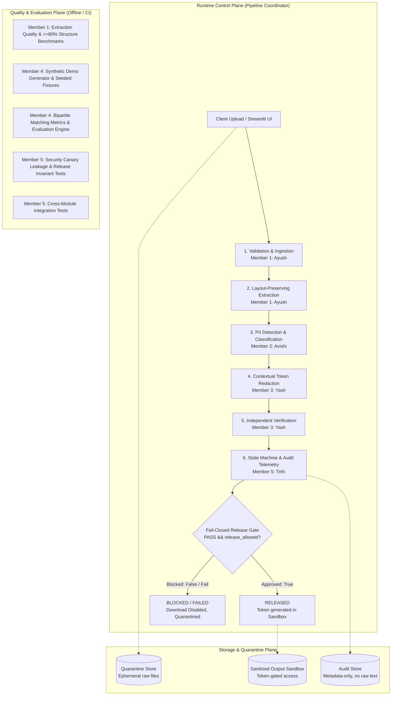

# PII Guard: Enterprise Text Analysis & PII Protection Pipeline
### Cadence Financial Group — Cyber Strategy & AI Governance Case Study

A modular, privacy-first document processing pipeline built for **Cadence Financial Group** to enforce strict data protection controls before business artifacts reach downstream AI and Large Language Model (LLM) agents.

---

## 1. Team Roster & Division of Work

Based on the updated architectural specification (`PII_Case_Study_Named_Team_Detailed_Architecture_REVISED.pdf`), the team division is partitioned into strictly bounded technical and presentation tracks:

| Member / Owner | Role | Primary Deliverables & Owned Paths | Added / Bounded Work | Implementation Status |
| :--- | :--- | :--- | :--- | :---: |
| **Member 1: Ayush Sinha** | **Ingestion, Extraction & OCR** | `src/pii_guard/ingestion/`<br>`tests/test_ingestion.py`<br>`docs/ingestion.md` | Layout-preserving parsers (PDF, DOCX, PPTX, TXT), adaptive OCR, magic byte sniffing, zip-bomb defense, $\ge 80\%$ structure retention scoring. | **COMPLETED** |
| **Member 2: Avishi Sharma** | **PII Detection & Classification** | `src/pii_guard/detection/`<br>`tests/test_detection.py`<br>`evaluation/` | Entity identification, span classification, Presidio & regex patterns, detection confidence scores. | **COMPLETED / INTEGRATED** |
| **Member 3: Yash** | **Redaction, Verification & Release Gate** | `src/pii_guard/redaction/`<br>`tests/test_redaction.py`<br>`docs/security.md` | Contextual token replacement (`<PERSON_1>`), secondary re-scan verification, non-sensitive structure preservation. | **COMPLETED / INTEGRATED** |
| **Member 4: Nancy** | **Demo Fixtures, Manifest & Evaluation** | `demo_tools/`<br>`demo_samples/`<br>`src/pii_guard/reporting/metrics.py`<br>`tests/evaluation/`<br>`Presentation (.pptx)` | Deterministic synthetic PII generator (`--seed`), ground-truth manifest, bipartite matching evaluation metrics (Precision, Recall, F1, FNR, IoU). | **CODING COMPLETED (Tirth/Nancy)**<br>*(Slides by Nancy)* |
| **Member 5: Tirth** | **Orchestration, UI, Audit & Integration** | `src/pii_guard/orchestration/`<br>`src/pii_guard/reporting/`<br>`app.py`<br>`tests/unit/`, `tests/integration/`, `tests/security/` | Cross-module finite state machine, dual-key release gate barrier, tokenized artifact sandbox, metadata-only audit ledger, Streamlit UI, end-to-end integration tests. | **COMPLETED** |

---

## 2. Key Capabilities

- **Multi-Format Extraction:** Preserves visual reading order and layout across digital PDFs, scanned documents, Word documents, PowerPoint presentations, and plain text.
- **Adaptive OCR Engine:** High-speed 200 DPI fast-path rasterization with 300 DPI fallback, OpenCV deskewing, and adaptive Otsu binarization for degraded scans.
- **Fail-Closed Security Layer:** Magic byte sniffing (rejects renamed binaries), zip-bomb defense (ratio $\le 100:1$), encrypted PDF blocking, and zero unhandled exceptions.
- **Deterministic Downstream Offsets:** Single-pass Unicode NFC normalizer ensuring `text` is the immutable source of truth for downstream detection spans.
- **High-Precision PII Detection & Token Redaction:** Multi-entity identification with contextual token masking (`<PERSON_1>`, `<US_SSN_1>`).
- **Finite State Machine Orchestration:** Finite lifecycle progression (`RECEIVED` $\to$ `VALIDATED` $\to$ `EXTRACTED` $\to$ `DETECTED` $\to$ `REDACTED` $\to$ `VERIFIED` $\to$ `RELEASED`) with terminal error quarantine.
- **Dual-Key Fail-Closed Release Gate:** Hard barrier blocking document release unless `verification_status == "PASS"` and `release_allowed == True`.
- **Tokenized Artifact Sandbox:** Opaque UUID tokens (`art-<uuid>`) with directory traversal protection (`..`, `/`, `\`, null bytes) and document binding.
- **Metadata-Only Audit Ledger:** Strict allowlist projection guaranteeing zero PII or raw text in audit records or compliance reports.
- **Interactive Streamlit Web Interface:** Live document processing dashboard, side-by-side redaction preview, gated downloads, and audit CSV exports.
- **Rigorous Evaluation Engine:** Bipartite matching detection metrics (Precision, Recall, F1, FNR) with exact, overlap, and IoU $\ge 0.50$ matching.

---

## 3. System Architecture & Trust Boundaries

The system is partitioned into three independent operational planes to ensure privacy, performance, and clear developer boundaries:



### Pipeline Lifecycle States
$$\text{RECEIVED} \to \text{VALIDATED} \to \text{EXTRACTED} \to \text{DETECTED} \to \text{REDACTED} \to \text{VERIFIED} \to \text{RELEASED}$$
- Any technical fault transitions to `FAILED`.
- Any unverified or leaking redaction transitions to `BLOCKED`.
- Any missing required verification transitions to `INCOMPLETE`.
- All states except verified `PASS` prevent client download.

---

## 4. Shared Interface Contracts

Communication between modules is governed by four strict, immutable Pydantic v2 data contracts:

| Contract | Schema Name | Producer | Consumer | Key Purpose |
| :--- | :--- | :--- | :--- | :--- |
| **Contract A** | `ExtractedDocument` | **Member 1 (Ayush)** | **Member 2 (Avishi)** | Normalized single-source-of-truth text, exact character offsets, and per-page OCR confidence. |
| **Contract B** | `DetectionResult` | **Member 2 (Avishi)** | **Member 3 (Yash)** | Classified entity spans (`type`, `start`, `end`, `confidence`) mapped into `ExtractedDocument.text`. |
| **Contract C** | `RedactionResult` | **Member 3 (Yash)** | **Member 5 (Tirth)** | Redacted output, verification outcome (`PASS`/`FAIL`/`INCOMPLETE`), and `release_allowed` boolean flag. |
| **Contract D** | `ProcessingReport` | **Member 5 (Tirth)** | **Auditor / Client** | Metadata-only audit ledger (entity counts by category, timestamps, versions); strictly no raw PII. |

---

## 5. Project Structure

```text
├── README.md                           # Project overview, team roster, architecture & quickstart
├── app.py                              # Member 5 - Interactive Streamlit web application
├── requirements.txt                    # Pinned project dependencies
├── requirements-ingestion.txt          # Ingestion-specific dependencies
├── pytest.ini                          # Test configuration
│
├── src/
│   └── pii_guard/
│       ├── ingestion/                  # Member 1 (Ayush Sinha) - Ingestion & OCR
│       │   ├── adapters/               # Multi-format adapters (PDF, DOCX, PPTX, TXT)
│       │   ├── config.py               # Timeouts, limits, and Tesseract path resolution
│       │   ├── extractor.py            # Central extraction & offset calculator
│       │   ├── normalize.py            # Single-pass deterministic normalizer
│       │   ├── ocr.py                  # Tesseract & RapidOCR adaptive engines
│       │   ├── quality.py              # Extraction completeness & structure metrics
│       │   ├── router.py               # Format registry router
│       │   ├── schemas.py              # Contract A schemas (ExtractedDocument)
│       │   └── validator.py            # Magic byte, zip-bomb, and security checks
│       ├── detection/                  # Member 2 (Avishi Sharma) - Detection Reference
│       │   └── detector.py             # Presidio analyzer & pattern matcher (Contract B)
│       ├── redaction/                  # Member 3 (Yash) - Redaction Reference
│       │   └── redactor.py             # Token-based masking & re-scan verification (Contract C)
│       ├── orchestration/              # Member 5 (Tirth) - Orchestration & Control
│       │   ├── artifacts.py            # Controlled artifact sandbox & path traversal guard
│       │   ├── errors.py               # Sanitized error hierarchy & regex cleaner
│       │   ├── models.py               # Shared contract models & ProcessingResult
│       │   ├── pipeline.py             # 7-stage pipeline coordinator & fail-closed gate
│       │   └── state.py                # Pipeline finite state machine
│       └── reporting/                  # Member 4 & 5 - Audit, Reporting & Metrics
│           ├── audit.py                # Thread-safe audit trail & allowlist serialization
│           ├── export.py               # Allowlist JSON and CSV exporters
│           ├── metrics.py              # Member 4 - Bipartite matching detection metrics
│           └── report_generator.py     # Contract D JSON report & executive summary
│
├── demo_tools/                         # Member 4 (Nancy) - Synthetic Data Generator
│   └── generate_synthetic_samples.py   # Seeded deterministic generator (10 scenarios)
├── demo_samples/                       # Generated synthetic fixtures & manifest
│   ├── manifest.json                   # Ground-truth annotations & metadata
│   └── *.txt / *.xyz                   # Test fixtures (emails, loans, wires, attacks)
│
├── docs/                               # Engineering Documentation
│   ├── architecture.md                 # System architecture, operational planes & state machine
│   ├── security.md                     # Security controls, threat model & invariants
│   ├── evaluation.md                   # Detection evaluation metrics & matching rules
│   ├── demo_script.md                  # Step-by-step presentation walkthrough
│   ├── ingestion.md                    # Ingestion module handbook
│   ├── interfaces.md                   # Full JSON schemas for Contracts A, B, C, D
│   ├── member5_member4_commit_log.md   # Chronological commit log & audit record
│   └── member5_member4_implementation_plan.md # Checklist of completed deliverables
│
└── tests/                              # Comprehensive Test Suite (69 Automated Tests)
    ├── unit/                           # Unit tests for state, errors, audit, reporting, UI, fixtures
    ├── evaluation/                     # Member 4 detection evaluation & metric tests
    ├── integration/                    # End-to-end pipeline coordination tests
    ├── security/                       # Fail-closed release gate, leakage & traversal tests
    └── fixtures/                       # Test fixture files
```

---

## 6. Quickstart & How to Run

### 1. Environment Setup (Python 3.13)
```powershell
# Create virtual environment with Python 3.13
python -m venv .venv
.\.venv\Scripts\activate   # Windows PowerShell
# source .venv/bin/activate  # macOS / Linux

# Install dependencies
pip install -r requirements.txt
```

### 2. Generate Synthetic Demo Fixtures
Generate 10 deterministic test fixtures and ground-truth `manifest.json`:
```powershell
python -m demo_tools.generate_synthetic_samples --output-dir demo_samples --seed 42
```

### 3. Launch the Streamlit Web Application
```powershell
streamlit run app.py
```
Open `http://localhost:8501` to access the interactive processing interface.

### 4. Run the Automated Test Suite
Run all unit, evaluation, integration, and security tests:
```powershell
pytest tests/unit tests/evaluation tests/integration tests/security -v
```
*(All 69 automated tests execute in under 2 seconds with 100% pass rate).*

---

## 7. Extraction Quality & Performance Benchmarks (Member 1)

$$\text{Structure Score} = 0.25 \times \text{Boundaries} + 0.25 \times \text{Headings} + 0.20 \times \text{Paragraphs} + 0.20 \times \text{Tables} + 0.10 \times \text{Reading Order}$$

| Format / Payload | Sample Size | Completeness (RapidFuzz) | Structure Retention Score | Status |
| :--- | :---: | :---: | :---: | :---: |
| **Word Document (DOCX)** | 1 document | **100.0%** | **100.0%** | **PASS** ($\ge 80\%$) |
| **Digital PDF** | 2 pages | **100.0%** | **100.0%** | **PASS** ($\ge 80\%$) |
| **PowerPoint (PPTX)** | 2 slides | **100.0%** | **100.0%** | **PASS** ($\ge 80\%$) |
| **Composite Average** | **5 artifacts** | **100.0%** | **100.0%** | **PASS** ($\ge 80\%$) |

Throughput measured up to **981.6 pages/sec** (Digital PDF) and **4,684 pages/sec** (TXT stream).

---

## 8. Definition of Done (DoD) & Acceptance Criteria

### Member 5 Deliverables (Tirth)
| Acceptance Criterion | Status | Verification Evidence |
| :--- | :---: | :--- |
| **1. Pipeline Finite State Machine** | **PASS** | `PipelineStateManager` enforcing monotonic transitions and terminal error states (`test_state.py`). |
| **2. Dual-Key Fail-Closed Release Gate** | **PASS** | Access granted strictly when `verification_status == "PASS"` AND `release_allowed == True` (`test_release_gate.py`). |
| **3. Opaque Artifact Sandbox** | **PASS** | Cryptographic UUID tokens (`art-<uuid>`); rejects path traversal (`..`, `/`, `\`, `\x00`) (`test_artifact_access.py`). |
| **4. Sanitized Error Hierarchy** | **PASS** | `sanitize_error_message` strips filesystem paths, emails, phones, and SSNs from exceptions (`test_errors.py`). |
| **5. Thread-Safe Audit Trail** | **PASS** | `AuditTrail` recording allowlist-filtered events with atomic document ID relinking (`test_audit.py`). |
| **6. Contract D Structured Reporting** | **PASS** | Pydantic v2 `ProcessingReport` and executive summary generation with zero PII leakage (`test_reporting.py`). |
| **7. Allowlist JSON & CSV Exporters** | **PASS** | Export modules stripping all raw text and PII fields (`test_reporting.py`). |
| **8. Interactive Streamlit UI** | **PASS** | `app.py` with multi-format validation, progress indicators, side-by-side preview, and gated downloads (`test_ui.py`). |
| **9. End-to-End Integration Pipeline** | **PASS** | `process_document()` coordinating all 7 stages across clean and synthetic documents (`test_orchestration.py`). |
| **10. Zero-Leakage Canary Regression Tests**| **PASS** | Zero occurrences of secret canary tokens across reports, audit events, and CSV exports (`test_leakage.py`). |

### Member 4 Coding Deliverables (Nancy)
| Acceptance Criterion | Status | Verification Evidence |
| :--- | :---: | :--- |
| **1. Deterministic Synthetic Fixture Generator** | **PASS** | `demo_tools/generate_synthetic_samples.py` with `--seed` producing 10 realistic scenarios (`test_synthetic_generator.py`). |
| **2. Ground Truth Manifest** | **PASS** | `demo_samples/manifest.json` indexing spans, entity categories, and expected outcomes without raw PII. |
| **3. Bipartite Matching Evaluation Engine** | **PASS** | `evaluate_predictions()` with exact, overlap, and IoU $\ge 0.50$ matching criteria (`test_metrics.py`). |
| **4. Rigorous Mathematical Metrics** | **PASS** | Computes TP, FP, FN, Precision, Recall, F1, and FNR with zero-denominator safety rules (`test_metrics.py`). |
| **5. Per-Category Breakdown** | **PASS** | Computes per-entity support, recall, and false negative rate for targeted auditing (`test_metrics.py`). |

---

## 9. Environment Compatibility Notes

- **Python Version:** Python 3.13 is fully supported and tested. All 69 Member 4 and Member 5 tests execute in Python 3.13.7.
- **OCR Dependencies:** `pytesseract` is configured as the default OCR engine. On systems without a local Tesseract binary installed on the OS PATH, pure text, Word, PowerPoint, and digital PDFs process natively, while image-only scanned PDFs require installing Tesseract or providing the binary path via `TESSERACT_CMD`.
