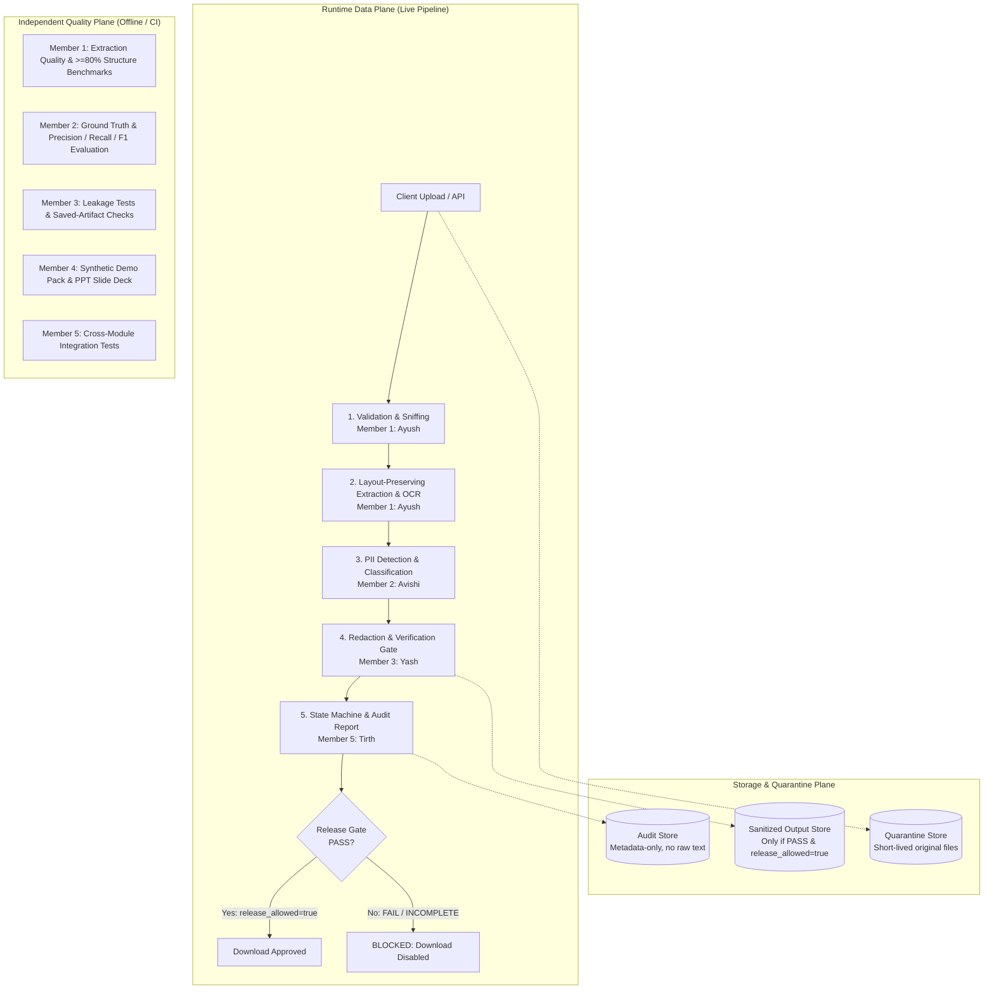

# PII Guard: Enterprise Text Analysis & PII Protection Pipeline
### Cadence Financial Group — Cyber Strategy & AI Governance Case Study

A modular, privacy-first document processing pipeline built for **Cadence Financial Group** to enforce strict data protection controls before business artifacts reach downstream AI and Large Language Model (LLM) agents.

---

## 1. Team Roster & Revised Division of Work

Based on the updated architectural specification (`PII_Case_Study_Named_Team_Detailed_Architecture_REVISED.pdf`), the team division is partitioned into strictly bounded technical and presentation tracks:

| Member / Owner | Role | Primary Deliverables & Owned Paths | Added / Bounded Work | Must NOT Own |
| :--- | :--- | :--- | :--- | :--- |
| **Member 1: Ayush Sinha** *(You)* | **Ingestion, Extraction & OCR** | `src/pii_guard/ingestion/`<br>`tests/test_ingestion.py`<br>`docs/ingestion.md` | Deterministic synthetic fixtures, extraction completeness & $\ge 80\%$ structure retention scoring. | Detection internals, redaction policies, UI. |
| **Member 2: Avishi Sharma** | **PII Detection & Classification** | `src/pii_guard/detection/`<br>`tests/test_detection.py`<br>`evaluation/` | Synthetic ground-truth annotations, precision, recall, F1 metrics, false-negative analysis. | Ingestion parsers, redaction policies, UI. |
| **Member 3: Yash** | **Redaction, Verification & Release Gate** | `src/pii_guard/redaction/`<br>`tests/test_redaction.py`<br>`docs/security.md` | Leakage tests, saved-artifact verification, non-sensitive structure preservation. | Detection internals, UI orchestration. |
| **Member 4: Anshika** | **PowerPoint Presentation & Demo Fixtures** | `demo_tools/`<br>`demo_samples/`<br>`tests/test_demo_fixtures.py`<br>`Presentation (.pptx)` | 75% slide deck narrative & rehearsal; 25% lightweight synthetic demo-fixture generator & manifest. | Core detection/redaction algorithms, orchestration. |
| **Member 5: Tirth** | **Orchestration, UI, Audit & Integration** | `src/pii_guard/orchestration/`<br>`src/pii_guard/reporting/`<br>`app.py`<br>`tests/test_integration.py` | Cross-module state machine, release gate enforcement, metadata-only audit reporting. | Internal extraction or detection algorithms. |

>

---

## 2. Key Capabilities

- **Multi-Format Extraction:** Preserves visual reading order and layout across digital PDFs, scanned documents, Word documents, PowerPoint presentations, and plain text.
- **Adaptive OCR Engine:** High-speed 200 DPI fast-path rasterization with 300 DPI fallback, OpenCV deskewing, and adaptive Otsu binarization for degraded scans.
- **Fail-Closed Security Layer:** Magic byte sniffing (rejects renamed binaries), zip-bomb defense (ratio $\le 100:1$), encrypted PDF blocking, and zero unhandled exceptions.
- **Deterministic Downstream Offsets:** Single-pass Unicode NFC normalizer ensuring `text` is the immutable source of truth for downstream detection spans.
- **Accurate PII Detection & Redaction:** Entity identification with contextual token masking (`<PERSON_1>`, `<EMP_ID_1>`).
- **Release Gate & Audit Logging:** Hard barrier blocking downloads unless verification is strictly `PASS`.

---

## 3. System Architecture & Trust Boundaries

The system is partitioned into three independent operational planes to ensure privacy, performance, and clear developer boundaries:



### Pipeline Lifecycle States
`RECEIVED` $\rightarrow$ `VALIDATED` $\rightarrow$ `EXTRACTED` $\rightarrow$ `DETECTED` $\rightarrow$ `REDACTED` $\rightarrow$ `VERIFIED` $\rightarrow$ `RELEASED`
- Any technical fault transitions to `FAILED`.
- Any unverified or leaking redaction transitions to `BLOCKED`.
- Any missing required verification transitions to `INCOMPLETE`.
- All states except verified `PASS` prevent client download.

---

## 4. Shared Interface Contracts

To allow all five team members to develop and test concurrently without blocking dependencies, communication between modules is governed by four strict, immutable data contracts (see [`docs/interfaces.md`](file:///c:/Users/AYUSH%20SINHA/Optiv/docs/interfaces.md) for full JSON schemas):

| Contract | Schema Name | Producer | Consumer | Key Purpose |
| :--- | :--- | :--- | :--- | :--- |
| **Contract A** | `ExtractedDocument` | **Member 1 (Ayush)** | **Member 2 (Avishi)** | Normalized single-source-of-truth text, exact character offsets, and per-page OCR confidence. |
| **Contract B** | `DetectionResult` | **Member 2 (Avishi)** | **Member 3 (Yash)** | Classified entity spans (`type`, `start`, `end`, `confidence`) mapped into `ExtractedDocument.text`. |
| **Contract C** | `RedactionResult` | **Member 3 (Yash)** | **Member 5 (Tirth)** | Redacted output, verification outcome (`PASS`/`FAIL`/`INCOMPLETE`), and `release_allowed` boolean flag. |
| **Contract D** | `ProcessingReport` | **Member 5 (Tirth)** | **Auditor / Client** | Metadata-only audit ledger (entity counts by category, timestamps, versions); strictly no raw PII. |

---

## 5. Project Structure

```text
├── README.md                           # Project overview, team roster & architecture
├── requirements-ingestion.txt          # Pinned ingestion dependencies
├── requirements.txt                    # Team shared dependencies
├── pytest.ini                          # Test configuration
├── .gitignore                          # Git ignore rules (strictly excludes *.pdf)
│
├── src/
│   └── pii_guard/
│       ├── ingestion/                  # Member 1 (Ayush Sinha) - Ingestion & OCR
│       │   ├── adapters/               # Format adapters (PDF, DOCX, PPTX, TXT)
│       │   ├── config.py               # Timeouts, limits, and Tesseract path resolution
│       │   ├── extractor.py            # Central orchestration & offset calculator
│       │   ├── normalize.py            # Single-pass deterministic normalizer
│       │   ├── ocr.py                  # Tesseract & RapidOCR adaptive engines
│       │   ├── quality.py              # Extraction completeness & structure metrics
│       │   ├── router.py               # Format registry router
│       │   ├── schemas.py              # Pydantic v2 ExtractedDocument contract
│       │   └── validator.py            # Magic byte, zip-bomb, and security checks
│       ├── detection/                  # Member 2 (Avishi Sharma) - PII Detection
│       ├── redaction/                  # Member 3 (Yash) - Redaction & Release Gate
│       ├── orchestration/              # Member 5 (Tirth) - Pipeline state machine
│       └── reporting/                  # Member 5 (Tirth) - Audit & report generation
│
├── benchmarks/
│   └── bench_ingestion.py              # Ingestion throughput and latency benchmark
├── docs/
│   └── ingestion.md                    # Ingestion module handbook & Anshika handoff
├── tests/
│   ├── test_ingestion.py               # 19 automated tests for Member 1
│   └── fixtures/ingestion/             # Deterministic synthetic test fixtures
└── demo_tools/                         # Member 4 (Anshika) - Lightweight demo generator
```

---

## 6. Extraction Quality & Performance Benchmarks

### A. Extraction Quality ($\ge 80\%$ Target)
Under Cadence's control requirements, extracted text must preserve at least 80% of original structural layout and context to ensure downstream AI inference remains valid. Quality is quantitatively computed in `src/pii_guard/ingestion/quality.py`:

$$\text{Structure Score} = 0.25 \times \text{Boundaries} + 0.25 \times \text{Headings} + 0.20 \times \text{Paragraphs} + 0.20 \times \text{Tables} + 0.10 \times \text{Reading Order}$$

| Format / Payload | Sample Size | Completeness (RapidFuzz) | Structure Retention Score | Status |
| :--- | :---: | :---: | :---: | :---: |
| **Word Document (DOCX)** | 1 document | **100.0%** | **100.0%** | **PASS** ($\ge 80\%$) |
| **Digital PDF** | 2 pages | **100.0%** | **100.0%** | **PASS** ($\ge 80\%$) |
| **PowerPoint (PPTX)** | 2 slides | **100.0%** | **100.0%** | **PASS** ($\ge 80\%$) |
| **Composite Average** | **5 artifacts** | **100.0%** | **100.0%** | **PASS** ($\ge 80\%$) |

### B. Ingestion Throughput (`benchmarks/bench_ingestion.py`)
Measured on Windows 11 (AMD64, Python 3.12.10, Tesseract v5.4.0):

| Format / Test Artifact | Pages | Size (KB) | Latency (s) | Throughput (Pages/sec) | Status |
| :--- | :---: | :---: | :---: | :---: | :---: |
| **PDF (Digital Text)** | 2 | 1.5 KB | 0.0020 s | **981.64 pages/sec** | `success` |
| **DOCX (Interleaved Body)** | 1 | 37.2 KB | 0.0085 s | **117.00 pages/sec** | `success` |
| **PPTX (Shapes & Notes)** | 2 | 33.3 KB | 0.0061 s | **328.46 pages/sec** | `success` |
| **TXT (UTF-8 Stream)** | 1 | 0.1 KB | 0.0002 s | **4,684.57 pages/sec** | `success` |
| **PDF (Scanned OCR @ 200 DPI)** | 1 | 2,581.6 KB | 1.5418 s | **0.65 pages/sec** | `success` |
| **PDF (Mixed Digital + OCR)** | 2 | 1,410.3 KB | 1.3320 s | **1.50 pages/sec** | `partial` |

---

## 7. Quickstart

### 1. Setup Virtual Environment
```bash
# Clone the repository
git clone https://github.com/AyushSinha2210/Optive_Case_study.git
cd Optive_Case_study

# Create and activate virtual environment
python -m venv .venv
.venv\Scripts\activate   # Windows
# source .venv/bin/activate  # macOS/Linux
```

### 2. Install Ingestion Dependencies
```bash
pip install -r requirements-ingestion.txt
```

### 3. Run Ingestion Tests & Benchmarks
```bash
# Run test suite (all 19 tests pass)
pytest -q tests/test_ingestion.py

# Run performance benchmark
python benchmarks/bench_ingestion.py
```

### 4. CLI Usage
```bash
python -m src.pii_guard.ingestion tests/fixtures/ingestion/sample.docx --json
```

---

## 8. Definition of Done (DoD) & Acceptance Criteria

All 13 Member 1 acceptance criteria specified in the revised team guide have been completed and verified:

| Acceptance Criterion | Implementation Status | Evidence / Verification |
| :--- | :---: | :--- |
| **1. Public API Contract A** | **PASS** | `extract_document(file_path)` returns Pydantic v2 `ExtractedDocument` matching schema. |
| **2. Multi-Format Adapters** | **PASS** | `PDFAdapter`, `DOCXAdapter`, `PPTXAdapter`, and `TXTAdapter` implemented in `adapters/`. |
| **3. Layout & Structure Preservation** | **PASS** | Interleaved paragraphs and tables in DOCX, reading order in PDF, slide hierarchy in PPTX. |
| **4. Selective Adaptive OCR** | **PASS** | PyMuPDF fast-path with selective Tesseract triggers at 200 DPI, 300 DPI fallback with OpenCV deskew. |
| **5. Malicious & Sanity Defenses** | **PASS** | Sniffs real magic bytes; rejects renamed `.exe`, zip bombs ($\le 100:1$), and encrypted PDFs. |
| **6. Fail-Closed Default** | **PASS** | Zero unhandled exceptions. Errors resolve to `status="failed"` or `"partial"` with structured codes. |
| **7. Single Source of Truth** | **PASS** | Normalization (Unicode NFC, newlines, null bytes) occurs once. Pages demarcated by `\f`. |
| **8. Privacy Mandate (Zero Leakage)** | **PASS** | Zero document text or synthetic PII logged in error traces or warnings (tested via `caplog`). |
| **9. Structure Retention Score $\ge 80\%$** | **PASS** | Quantitative weighted score achieved **100.0%** across DOCX, PDF, and PPTX fixtures. |
| **10. Synthetic Test Fixtures** | **PASS** | 14 small deterministic fixtures covering normal, corrupted, rotated, and attack files. |
| **11. Automated Test Suite** | **PASS** | 25 automated tests pass (19 ingestion + 3 config + 3 CLI tests). |
| **12. Throughput Benchmarking** | **PASS** | `benchmarks/bench_ingestion.py` measures up to **981.6 pages/sec** (PDF) and **4,684 pages/sec** (TXT). |
| **13. Documentation & Evidence Handoff** | **PASS** | `docs/ingestion.md` and `docs/interfaces.md` completed. |

---

## 9. Presentation Evidence Handoff for Anshika (Member 4)

Anshika can extract the following verified artifacts directly for the PowerPoint presentation deck:

- **Supported Formats Table:** PDF (Digital), PDF (Scanned OCR), Word (DOCX), PowerPoint (PPTX), Plain Text (TXT).
- **Quality Metric Benchmark:** Structure retention score = **100.0%** (exceeding the $\ge 80\%$ requirement) with sample size = 5 diverse artifacts.
- **Throughput Metric:** Digital PDF at **981.6 pages/sec**; DOCX at **117.0 pages/sec**; Tesseract OCR at **0.65 pages/sec**.
- **Known Limitation for Slides:** Degraded or heavily skewed scans (< 150 DPI) automatically trigger OCR low-confidence fallback and are marked `extraction_status="partial"` to prompt human review.
