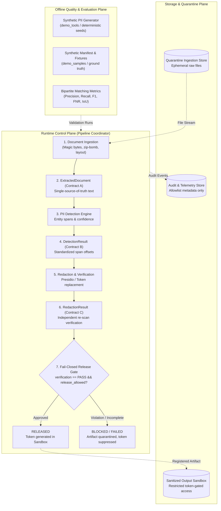
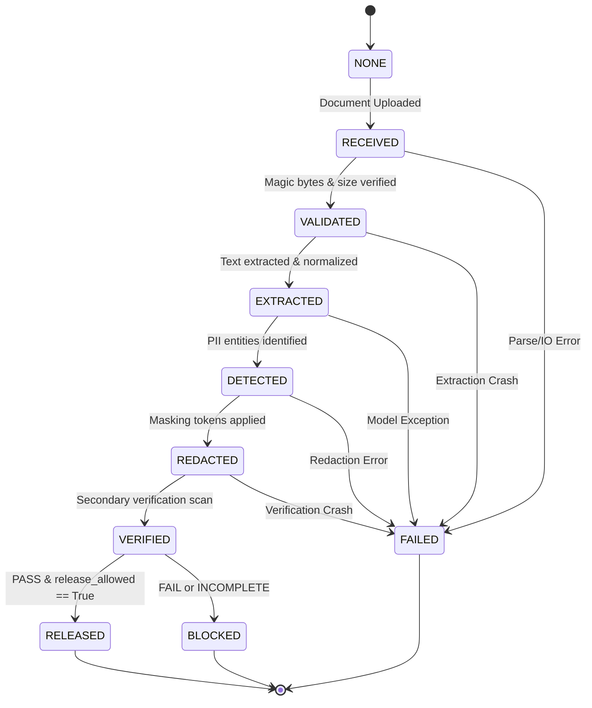

# PII Guard: System Architecture & Orchestration Specification
### Cadence Financial Group — Cyber Strategy & AI Governance Case Study
**Author:** Tirth (Member 5: Orchestration, UI, Audit & Integration)  
**Cross-Functional Ownership:** Nancy (Member 4 Coding Deliverables: Synthetic Fixtures & Evaluation)

---

## 1. Executive Summary & Architectural Vision

Cadence Financial Group requires enterprise-grade PII detection and redaction controls before unstructured customer and corporate documents reach downstream Large Language Model (LLM) agents and generative AI workflows. 

The **PII Guard** architecture enforces strict privacy and governance boundaries through:
1. **Separation of Concerns:** Independent operational planes separating real-time execution, artifact quarantine/storage, and offline evaluation.
2. **Standardized Communication Contracts:** Strict data contracts (Contracts A, B, C, D) defined with Pydantic v2 schemas to decouple ingestion, detection, redaction, and reporting.
3. **Deterministic State Machine:** A finite state machine governing document lifecycle transitions with zero silent failures.
4. **Fail-Closed Release Barrier:** Hardware and software gates blocking document export or downstream dissemination unless cryptographic verification passes with zero unmasked PII.
5. **Zero-Leakage Observability:** Metadata-only audit trails and structured reports strictly prohibited from logging raw PII spans or unredacted document fragments.

---

## 2. Operational Planes & Trust Boundaries

The system is partitioned into three independent operational planes:

### Trust Boundary Rules
- **Boundary 1 (External Upload $\to$ Ingestion):** Untrusted input. Validated for file size ($\le 50\text{ MB}$), MIME type, real magic bytes, zip-bomb compression ratios ($\le 100:1$), and password encryption.
- **Boundary 2 (Internal Runtime Spans):** PII detection and redaction operate on UTF-8 normalized text (`\f` page breaks) using character offsets.
- **Boundary 3 (Runtime $\to$ Audit/Reporting):** Strict projection filter. No raw document text, snippets, or entity values cross this boundary. Only entity counts, entity categories, hashes, and timestamps are recorded.
- **Boundary 4 (Runtime $\to$ Client Egress):** The Fail-Closed Release Gate. Redacted files are never written to arbitrary client paths; access is mediated through opaque tokens within an isolated artifact sandbox.

---

## 3. Component Contracts Architecture

Communication between pipeline stages is strictly decoupled via four canonical contracts:

| Contract | Schema Name | Producer | Consumer | Key Attributes & Guarantees |
| :--- | :--- | :--- | :--- | :--- |
| **Contract A** | `ExtractedDocument` | **Member 1 (Ayush)** | **Member 2 (Avishi)** | `document_id`, `text` (single source of truth), `pages` with bounding boxes, character offsets, `ocr_applied`, `structure_retention_score`. |
| **Contract B** | `DetectionResult` | **Member 2 (Avishi)** | **Member 3 (Yash)** | `document_id`, `entities` list of `DetectedEntity` (`entity_id`, `entity_type`, `start`, `end`, `confidence`, `detector_name`). Zero overlap ambiguity. |
| **Contract C** | `RedactionResult` | **Member 3 (Yash)** | **Member 5 (Tirth)** | `document_id`, `redacted_text`, `redacted_file_path`, `replacements` summary, `verification_status` (`PASS`/`FAIL`/`INCOMPLETE`), `release_allowed` boolean. |
| **Contract D** | `ProcessingReport` | **Member 5 (Tirth)** | **Auditors / Executives** | `report_id`, `document_id`, `state`, `verification_status`, `release_allowed`, `entity_counts_by_category`, `execution_time_ms`, `total_entities_detected`. Strictly zero raw text. |

### Contract Alignment Implementation
- Ingestion produces an internal document ID (`doc-...`). The Pipeline Coordinator adopts this canonical ID and links all preceding ingestion audit entries via `trail.relink_document_id(initial_id, canonical_id)`.
- If a downstream module produces a generic dict or mock response, the coordinator normalizes it through `ProcessingResult` and Contract D models with Pydantic validation before state transitions.

---

## 4. Pipeline State Machine

The document processing lifecycle is modeled as a strictly monotonic finite state machine with terminal error states (`src/pii_guard/orchestration/state.py`):

### State Machine Transition Rules
1. **Monotonic Forward Progression:** Normal processing moves forward one stage at a time: `RECEIVED` $\to$ `VALIDATED` $\to$ `EXTRACTED` $\to$ `DETECTED` $\to$ `REDACTED` $\to$ `VERIFIED` $\to$ `RELEASED`.
2. **Terminal State Immutability:** Once a document enters `RELEASED`, `BLOCKED`, or `FAILED`, no further transitions are allowed. Attempting a transition raises `StateTransitionError`.
3. **Fail-Closed Terminal Transitions:** Any unhandled exception or failed condition transitions directly to `FAILED`. If verification finishes but finds remaining PII or was not executed, it transitions to `BLOCKED`.

---

## 5. Fail-Closed Release Gate

The core security invariant of PII Guard is that **no document may be downloaded or exported unless it explicitly passes the dual-key release gate**:

$$\text{Release Granted} \iff (\text{verification\_status} == \text{"PASS"}) \land (\text{release\_allowed} == \text{True})$$

### Invariant Table
| Stage State | `verification_status` | `release_allowed` | Release Gate Action | Artifact Token Generated? | Client Download Available? |
| :---: | :---: | :---: | :---: | :---: | :---: |
| `VERIFIED` | `"PASS"` | `True` | **AUTHORIZED** | **YES** (`art-<uuid>`) | **YES** |
| `VERIFIED` | `"FAIL"` | `False` | **BLOCKED** | **NO** (`None`) | **NO (Disabled)** |
| `VERIFIED` | `"PASS"` | `False` | **BLOCKED** | **NO** (`None`) | **NO (Disabled)** |
| `VERIFIED` | `"INCOMPLETE"` | `False` | **BLOCKED** | **NO** (`None`) | **NO (Disabled)** |
| `FAILED` | Any / None | `False` | **BLOCKED** | **NO** (`None`) | **NO (Disabled)** |
| Unhandled Exception | N/A | `False` | **BLOCKED** | **NO** (`None`) | **NO (Disabled)** |

### Gate Implementation Details
- In `src/pii_guard/orchestration/pipeline.py`, the coordinator inspects `redaction_res.verification_status` and `redaction_res.release_allowed`.
- Only when both conditions hold does the pipeline call `artifact_store.register_artifact(doc_id, redacted_path)` and transition to `PipelineStage.RELEASED`.
- In `app.py` (Streamlit UI), the download button widget is conditionally rendered with `disabled=True` unless `st.session_state.processing_result.release_allowed` is `True` and `result.verification_status == "PASS"`.

---

## 6. Artifact Sandbox & Traversal Defense

Direct client access to the local filesystem is prohibited. All redacted output artifacts are isolated inside a dedicated runtime sandbox (`src/pii_guard/orchestration/artifacts.py`):

1. **Opaque Tokens:** Files are indexed via cryptographically random UUID tokens (`art-3f8a9...`). The token reveals nothing about the document ID, underlying file path, or user identity.
2. **Path Traversal Rejection:** Any token containing `..`, `/`, `\`, or null bytes (`\x00`) is immediately rejected with an `ArtifactSecurityError` without hitting the filesystem.
3. **Document ID Binding:** Retrieving an artifact requires presenting both the valid `artifact_token` AND the owning `document_id`. Cross-document token re-use is blocked.
4. **Symlink and Jail Escapes:** When reading an artifact, `os.path.realpath` resolves the target file and asserts that the path resides strictly inside `sandbox_dir`.

---

## 7. Metadata-Only Audit Trail & Reporting

Compliance with Cadence Financial Group's security mandate prohibits persisting raw PII inside application logs or compliance reports.

### Allowlist Enforcement
- The `AuditEvent` model strictly whitelists permitted fields: `event_id`, `timestamp`, `event_type`, `stage`, `document_id`, `details`, and `actor`.
- The `details` dictionary is filtered through an allowlist: only integer counts, categories, and execution timestamps are serialized. Keys such as `text`, `raw_text`, `entity_value`, or `content` are unconditionally stripped.
- The `AuditTrail` maintains an in-memory thread-safe event log with atomic relinking capabilities for document IDs.

---

## 8. Synthetic Fixtures & Detection Evaluation Architecture (Member 4 Integration)

To validate the end-to-end pipeline without exposing real consumer financial records, Member 4's deliverables provide an evaluation plane:

1. **Deterministic Synthetic Data Generator (`demo_tools/generate_synthetic_samples.py`):**
   - Implements 10 distinct scenario generators covering standard emails, loan applications, cross-border wires, medical disclosures, and attack vectors (malformed binaries, zip bombs).
   - Driven by pseudo-random seeds (`--seed 42`) using RFC 5737 documentation networks (`@example.com`, `555-01xx`, `000-xx-xxxx`).
2. **Ground Truth Manifest (`demo_samples/manifest.json`):**
   - Catalogs each fixture with its scenario, expected entity counts, category breakdowns, and expected verification outcome.
   - Ground truth spans record character bounds `[start, end]` and entity type without storing sensitive consumer identities.
3. **Bipartite Matching Metrics Engine (`src/pii_guard/reporting/metrics.py`):**
   - Matches predicted spans against ground truth using exact boundary, overlap, or Intersection-over-Union (IoU $\ge 0.50$) criteria.
   - Computes True Positives ($TP$), False Positives ($FP$), False Negatives ($FN$), Precision, Recall, $F_1$, and False Negative Rate ($FNR$).
   - Implements zero-denominator conventions: when both ground truth and predictions are empty, Precision, Recall, and $F_1$ are defined as 1.0.
