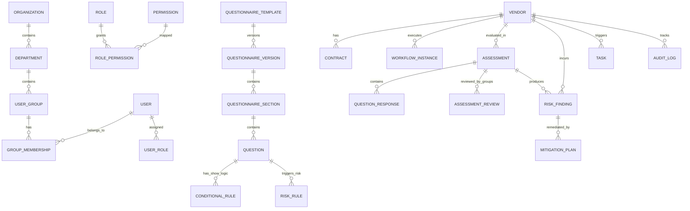

# Relational Data Model Specification: Cadence TPRM Application

**Engine:** SQLite 3 (Dev/Test) / PostgreSQL (Production)  
**ORM:** SQLAlchemy 2.0 (Declarative with Mapped columns and strict ForeignKeys)  
**Authority:** `Cadence_TPRM_Training.docx`  

---

## 1. Entity Relationship Diagram (ERD)

---

## 2. Table Specifications

### 2.1 Identity & Access Management
1. **`organizations`**
   - `id`: String(36), PK
   - `name`: String(255), Unique, Not Null
   - `domain`: String(255), Not Null
   - `created_at`: DateTime(timezone=True)
2. **`departments`**
   - `id`: String(36), PK
   - `organization_id`: String(36), FK(`organizations.id`), Not Null
   - `name`: String(100), Not Null (e.g. Legal, Security, IT, Procurement, Finance)
   - `code`: String(50), Unique, Not Null
3. **`user_groups`**
   - `id`: String(36), PK
   - `name`: String(100), Unique, Not Null (e.g. `Vendor Risk Management Group`, `Security Group`)
   - `description`: Text
   - `default_permission`: Enum(`Admin`, `Edit`)
4. **`users`**
   - `id`: String(36), PK
   - `email`: String(255), Unique, Not Null
   - `full_name`: String(255), Not Null
   - `is_active`: Boolean, Default=True
   - `created_at`: DateTime(timezone=True)
5. **`group_memberships`**
   - `id`: String(36), PK
   - `user_id`: String(36), FK(`users.id`), Not Null
   - `group_id`: String(36), FK(`user_groups.id`), Not Null
   - `role_in_group`: Enum(`Admin`, `Edit`), Not Null
   - UniqueConstraint(`user_id`, `group_id`)

### 2.2 Vendor Domain (Table 9 Attributes)
6. **`vendors`**
   - `id`: String(36), PK
   - `name`: String(255), Not Null
   - `type`: Enum(`Consulting`, `Operations`, `Regulatory`, `Strategic`, `Technology`, `Unknown`), Not Null
   - `criticality`: Enum(`Critical`, `High`, `Medium`, `Low`), Not Null
   - `primary_vendor_contact`: String(255), Not Null (Email)
   - `business_owner`: String(255), Not Null (Email)
   - `vendor_tier`: Enum(`Tier 1`, `Tier 2`, `Tier 3`), Not Null
   - `vendor_category`: Enum(`Service Provider and Vendor`, `Revenue Partner`, `Marketing Partner`, `Staffing Vendor`, `International Vendor`), Not Null
   - `website`: String(255)
   - `lifecycle_status`: Enum(`New`, `Assessment`, `Live`, `Rejected`, `Offboarding`, `Closed`), Default=`New`
   - `current_workflow_id`: String(36), FK(`workflows.id`)
   - `current_stage`: String(100)
   - `last_assessment_completion_date`: DateTime(timezone=True), Nullable
   - `next_reassessment_due_date`: DateTime(timezone=True), Nullable
   - `created_at`: DateTime(timezone=True)
   - `updated_at`: DateTime(timezone=True)

7. **`contracts`**
   - `id`: String(36), PK
   - `vendor_id`: String(36), FK(`vendors.id`), Not Null
   - `contract_reference`: String(100), Unique
   - `source`: Enum(`Ironclad`, `Manual`), Default=`Ironclad`
   - `effective_date`: Date
   - `expiration_date`: Date
   - `status`: String(50)

### 2.3 Questionnaire & Risk Domain
8. **`questionnaire_templates`**
   - `id`: String(36), PK
   - `code`: String(100), Unique, Not Null (`T1-2_v1`, `T3_v1`)
   - `name`: String(255), Not Null
   - `description`: Text
   - `active_version`: Integer, Default=1

9. **`questionnaire_sections`**
   - `id`: String(36), PK
   - `template_code`: String(100), Not Null
   - `section_number`: Integer, Not Null
   - `title`: String(255), Not Null (e.g. `1. Contracting and Legal`, `4. Data Privacy and Security`)
   - `responsible_group_name`: String(100), Not Null

10. **`questions`**
    - `id`: String(36), PK
    - `section_id`: String(36), FK(`questionnaire_sections.id`), Not Null
    - `question_code`: String(50), Not Null (e.g. `1.3`, `4.11`, `4.34`)
    - `prompt`: Text, Not Null
    - `question_type`: Enum(`YesNo`, `SingleChoice`, `MultiChoice`, `Text`, `FileUpload`)
    - `options`: JSON, Nullable
    - `is_required`: Boolean, Default=True
    - `order_index`: Integer

11. **`conditional_rules`**
    - `id`: String(36), PK
    - `rule_code`: String(50), Unique, Not Null (`CL.1` to `CL.14`)
    - `trigger_question_code`: String(50), Not Null
    - `trigger_operator`: Enum(`Equal To`, `Not Equal To`, `Contains`)
    - `trigger_value`: String(100), Not Null
    - `target_question_codes`: JSON, Not Null (e.g. `["1.6", "1.7", "1.8"]`)

12. **`risk_rules`**
    - `id`: String(36), PK
    - `rule_code`: String(50), Unique, Not Null (`QR.1` to `QR.90`)
    - `questionnaire_code`: String(100), Not Null
    - `trigger_question_code`: String(50), Not Null
    - `trigger_operator`: String(50), Not Null
    - `trigger_value`: String(100), Not Null
    - `risk_name`: String(255), Not Null
    - `inherent_risk`: Enum(`High`, `Medium`, `Low`), Not Null
    - `control_id`: String(50), Not Null (`QRC_*`)
    - `control_name`: String(255), Not Null
    - `target_user_group`: String(100), Nullable

### 2.4 Assessment & Evaluation Domain
13. **`assessments`**
    - `id`: String(36), PK
    - `vendor_id`: String(36), FK(`vendors.id`), Not Null
    - `template_code`: String(100), Not Null
    - `respondent_email`: String(255), Not Null
    - `approver_group`: String(100), Default=`Vendor Risk Management Group`
    - `status`: Enum(`Draft`, `Submitted`, `In Review`, `Approved`, `Rejected`), Default=`Draft`
    - `score`: Float, Nullable
    - `submitted_at`: DateTime(timezone=True), Nullable
    - `completed_at`: DateTime(timezone=True), Nullable
    - `decision_reason`: Text, Nullable
    - `decision_by`: String(255), Nullable

14. **`question_responses`**
    - `id`: String(36), PK
    - `assessment_id`: String(36), FK(`assessments.id`), Not Null
    - `question_code`: String(50), Not Null
    - `response_value`: Text, Not Null
    - `evidence_file_name`: String(255), Nullable
    - UniqueConstraint(`assessment_id`, `question_code`)

15. **`risk_findings`**
    - `id`: String(36), PK
    - `assessment_id`: String(36), FK(`assessments.id`), Not Null
    - `vendor_id`: String(36), FK(`vendors.id`), Not Null
    - `rule_code`: String(50), Not Null
    - `risk_name`: String(255), Not Null
    - `inherent_risk`: Enum(`High`, `Medium`, `Low`), Not Null
    - `control_id`: String(50), Not Null
    - `control_name`: String(255), Not Null
    - `responsible_group`: String(100), Not Null
    - `status`: Enum(`Open`, `Acknowledged`, `Remediating`, `Accepted`, `Closed`), Default=`Open`
    - `mitigation_recommendation`: Text
    - `due_date`: DateTime(timezone=True), Not Null

16. **`assessment_reviews`**
    - `id`: String(36), PK
    - `assessment_id`: String(36), FK(`assessments.id`), Not Null
    - `user_group_name`: String(100), Not Null
    - `reviewer_email`: String(255), Not Null
    - `review_notes`: Text
    - `status`: Enum(`Pending`, `Approved`, `ChangesRequested`), Default=`Pending`
    - `reviewed_at`: DateTime(timezone=True)

### 2.5 Workflows & Tasks
17. **`workflows`**
    - `id`: String(36), PK
    - `name`: String(100), Unique, Not Null (e.g. `CD_Onboarding Workflow`, `CD_Tier3 Workflow`)
    - `description`: Text
    - `is_active`: Boolean, Default=True

18. **`workflow_instances`**
    - `id`: String(36), PK
    - `workflow_id`: String(36), FK(`workflows.id`), Not Null
    - `vendor_id`: String(36), FK(`vendors.id`), Not Null
    - `current_stage`: String(100), Not Null
    - `started_at`: DateTime(timezone=True)
    - `completed_at`: DateTime(timezone=True), Nullable

19. **`workflow_transitions`**
    - `id`: String(36), PK
    - `workflow_instance_id`: String(36), FK(`workflow_instances.id`), Not Null
    - `actor_email`: String(255), Not Null
    - `from_stage`: String(100), Not Null
    - `to_stage`: String(100), Not Null
    - `trigger_name`: String(100), Not Null
    - `transition_reason`: Text
    - `created_at`: DateTime(timezone=True)

20. **`tasks`**
    - `id`: String(36), PK
    - `title`: String(255), Not Null
    - `vendor_id`: String(36), FK(`vendors.id`), Not Null
    - `assessment_id`: String(36), FK(`assessments.id`), Nullable
    - `task_type`: String(100), Not Null
    - `assignee_email`: String(255), Nullable
    - `collaborator_group`: String(100), Nullable
    - `due_date`: DateTime(timezone=True), Not Null
    - `reminder_date`: DateTime(timezone=True), Nullable
    - `status`: Enum(`Pending`, `In Progress`, `Completed`, `Overdue`), Default=`Pending`
    - `created_at`: DateTime(timezone=True)
    - `completed_at`: DateTime(timezone=True), Nullable

21. **`notifications`**
    - `id`: String(36), PK
    - `recipient_email`: String(255), Not Null
    - `subject`: String(255), Not Null
    - `body`: Text, Not Null
    - `notification_type`: Enum(`InApp`, `Email`), Default=`InApp`
    - `is_read`: Boolean, Default=False
    - `created_at`: DateTime(timezone=True)

22. **`audit_logs`**
    - `id`: String(36), PK
    - `actor_email`: String(255), Not Null
    - `action`: String(100), Not Null
    - `entity_type`: String(100), Not Null
    - `entity_id`: String(100), Not Null
    - `details`: JSON, Not Null
    - `timestamp`: DateTime(timezone=True), Not Null
