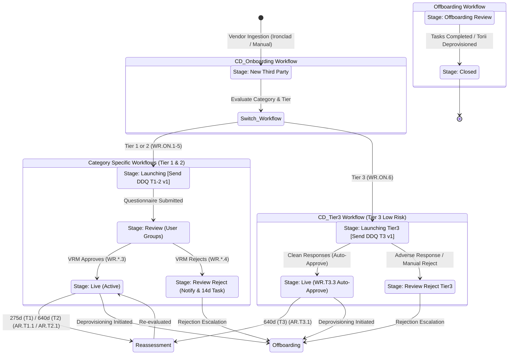

# Workflow Specification: Cadence TPRM State Machines

**Authority:** `Cadence_TPRM_Training.docx` Section 4.2, 5.1, 6.4, Appendix A, Tables 6, 7, 8, 10  

---

## 1. Top-Level Workflow Architecture

The Cadence TPRM platform executes 7 distinct workflows:
1. `CD_Onboarding Workflow` (Gateway FSM for all new third parties)
2. `CD_Revenue Partners Workflow` (Tier 1 & Tier 2)
3. `CD_Marketing Partners Workflow` (Tier 1 & Tier 2)
4. `CD_Service Providers Workflow` (Tier 1 & Tier 2)
5. `CD_Staffing Vendors Workflow` (Tier 1 & Tier 2)
6. `CD_International Vendors Workflow` (Tier 1 & Tier 2)
7. `CD_Tier3 Workflow` (Tier 3 across all categories)

In addition, two lifecycle extension workflows are supported:
- `Renewal Workflow` (Reassessment driven by `AR.T1.1`, `AR.T2.1`, `AR.T3.1`)
- `Offboarding Workflow` (Deprovisioning and closure)

---

## 2. Formal Stage & Rule Catalog (Table 10)

### 2.1 Onboarding Workflow (`CD_Onboarding Workflow`)
- **Stage 1:** `New Third Party`
  - Trigger: `On_T_Assign Workflow` (Vendor Created).
  - Evaluates Vendor Category & Vendor Tier:
    - If Category == `Revenue Partner` AND Tier in `[Tier 1, Tier 2]` -> Route to `CD_Revenue Partners Workflow`, stage `Launching RevPart` (`WR.ON.1`).
    - If Category == `Marketing Partner` AND Tier in `[Tier 1, Tier 2]` -> Route to `CD_Marketing Partners Workflow`, stage `Launching MarPart` (`WR.ON.2`).
    - If Category == `International Vendor` AND Tier in `[Tier 1, Tier 2]` -> Route to `CD_International Vendors Workflow`, stage `Launching IntVen` (`WR.ON.3`).
    - If Category == `Service Provider and Vendor` AND Tier in `[Tier 1, Tier 2]` -> Route to `CD_Service Providers Workflow`, stage `Launching ServPro` (`WR.ON.4`).
    - If Category == `Staffing Vendor` AND Tier in `[Tier 1, Tier 2]` -> Route to `CD_Staffing Vendors Workflow`, stage `Launching StafVen` (`WR.ON.5`).
    - If Tier == `Tier 3` (Regardless of Category) -> Route to `CD_Tier3 Workflow`, stage `Launching Tier3` (`WR.ON.6`).

### 2.2 Tier 1 & 2 Execution Rules (`WR.RP.*`, `WR.MP.*`, `WR.IV.*`, `WR.SP.*`, `WR.SV.*`)
1. **Rule 1 (Push to Next):** Advances from Initiated to Launching.
2. **Rule 2 (Send Questionnaire):** Stage rule launching `Due Diligence Questionnaire T1-2 v1`. Sets Respondent = Primary Vendor Contact, Approver = `Vendor Risk Management Group`.
3. **Rule 3 (Assessment Approved):** Moves from Launching/Review to `Live` when approved by VRM Admin.
4. **Rule 4 (Assessment Rejected):** Moves from Launching/Review to `Review Reject` when rejected by VRM Admin.
5. **Rule 5 (Notify Reject):** Stage rule on `Review Reject` sending rejection notification and creating a task for the internal `Business Owner` (Collaborator: `Vendor Risk Management Group`, Deadline: 14 Days).
6. **Rule 6 (Notify Approval):** Stage rule on `Live` sending approval notification to stakeholders.

### 2.3 Tier 3 Execution Rules (`WR.T3.*`)
1. **Rule `WR.T3.1` (T3 Push to Next):** Advances to `Launching Tier3`.
2. **Rule `WR.T3.2` (Send Tier 3 Questionnaire):** Launches `Due Diligence Questionnaire T3 v1`.
3. **Rule `WR.T3.3` (T3 Auto-Approve):** When all required responses are favorable (`QR.73`), automatically completes assessment and advances stage to `Live` with comment *"The third-party is Approved"*.
4. **Rule `WR.T3.4` (T3 Rejected):** If unfavorable risk or manual rejection, advances to `Review Reject Tier3`.
5. **Rule `WR.T3.5` (Notify Tier 3 Reject):** Rejection notification and 14-day task for `Business Owner`.
6. **Rule `WR.T3.6` (Notify Tier 3 Approval):** Approval notification to stakeholders.

### 2.4 Automation Reassessment Rules (`AR.T1.1`, `AR.T2.1`, `AR.T3.1`)
- **`AR.T1.1` (Tier 1 Reassessment):** Runs daily. Checks if `Last Assessment Completion Date` >= 275 days (90 days before 1 year anniversary). Dispatches `Due Diligence Questionnaire T1-2 v1`, copying prior answers, and sends `Vendor Upcoming Re-Assessment` email to `Business Owner`.
- **`AR.T2.1` (Tier 2 Reassessment):** Runs daily. Checks if `Last Assessment Completion Date` >= 640 days (90 days before 2 year anniversary). Dispatches `Due Diligence Questionnaire T1-2 v1`, copying prior answers, and notifies `Business Owner`.
- **`AR.T3.1` (Tier 3 Reassessment):** Runs daily. Checks if `Last Assessment Completion Date` >= 640 days (90 days before 2 year anniversary). Dispatches `Due Diligence Questionnaire T3 v1`, copying prior answers, and notifies `Business Owner`.
